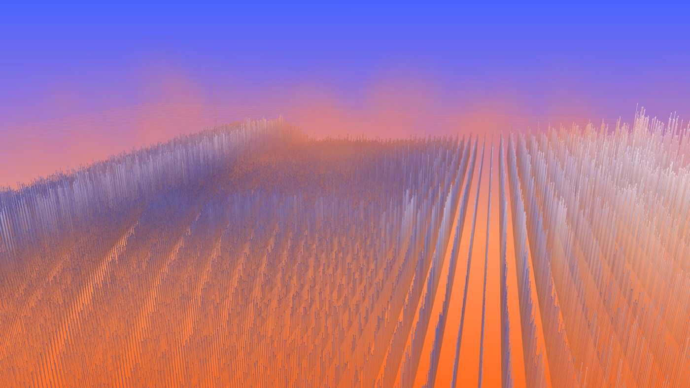
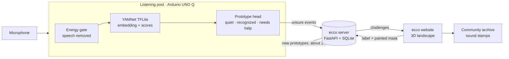
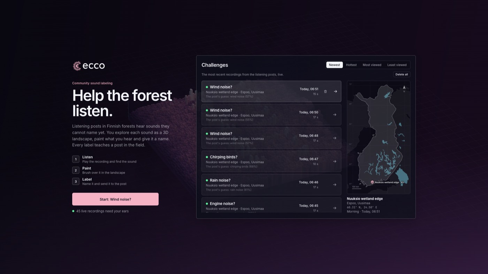
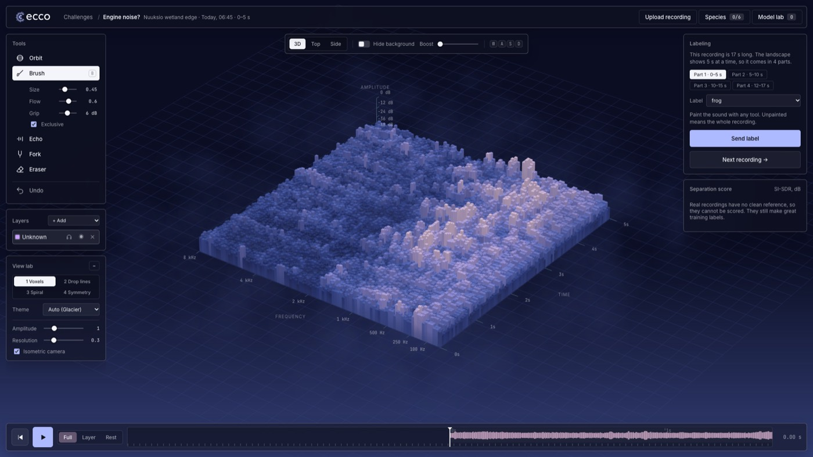
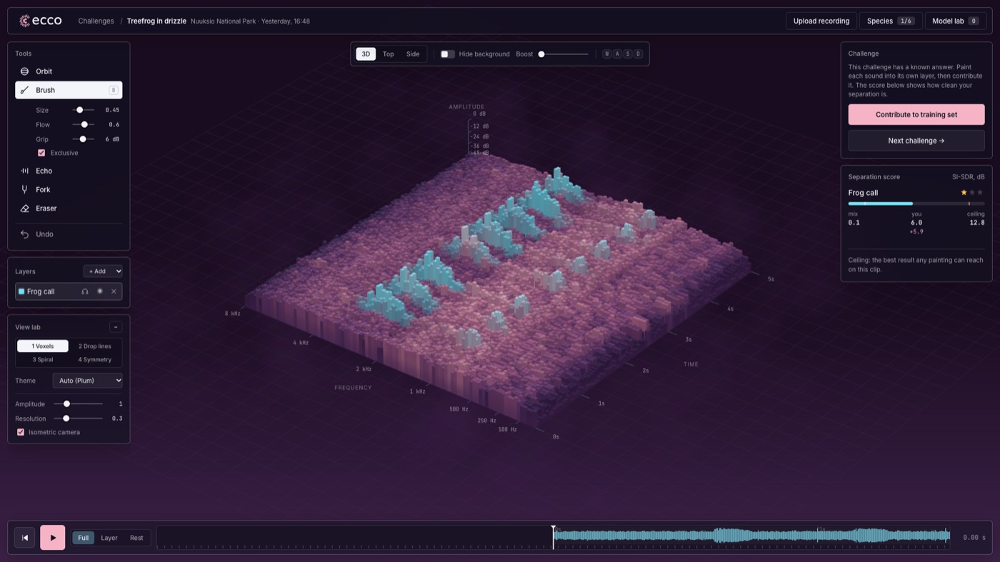
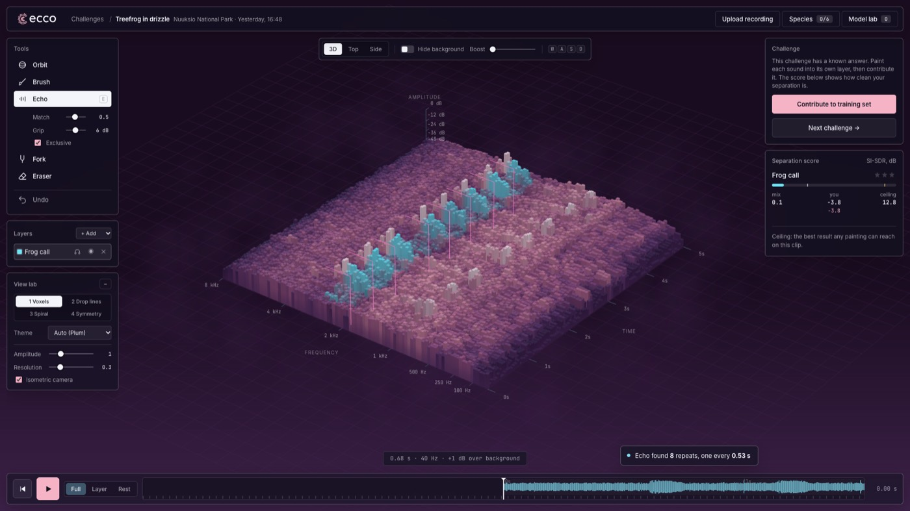
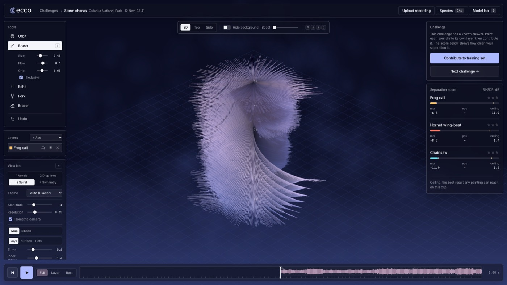

<p align="center">
  
</p>

<h3 align="center">Hear it on the edge. See it in 3D. Teach it together.</h3>

<p align="center">
  Edge AI listening posts on the Arduino UNO Q, and a community that teaches them new sounds<br>
  by exploring each recording as a 3D landscape.<br>
  <b>Built in one weekend at Junction 2026.</b>
</p>



---

## Contents

- [The idea](#the-idea)
- [What it does](#what-it-does)
- [How it works](#how-it-works)
- [Screenshots](#screenshots)
- [Tech stack](#tech-stack)
- [Models](#models)
- [Getting started](#getting-started)
- [How the project evolved](#how-the-project-evolved)
- [Challenges we ran into](#challenges-we-ran-into)
- [What we are proud of](#what-we-are-proud-of)
- [Outlook](#outlook)
- [Repository map](#repository-map)
- [Credits and licenses](#credits-and-licenses)

---

## The idea

**Forests are full of voices.** Frogs, birds and insects tell us how healthy a habitat is. Some of them are disappearing, and almost nobody is listening.

**Listening is not the bottleneck, labeling is.** Small devices can record day and night. But a model can only recognize what someone has labeled first. High-quality labeling is slow and tiring, and it is mostly done for big AI companies that keep the data.

**Our answer has three parts:**

1. **Hear it on the edge.** Small listening posts built on the **Arduino UNO Q** recognize animal calls on the spot, in milliseconds, without the cloud. Human speech is removed right on the device, so posts can listen even in busy places like national parks.
2. **See it in 3D.** When a post hears a sound it cannot name, it asks the community for help. On the ecco website, that sound becomes a **3D landscape** you can explore. Time runs along one axis, pitch along the other, and loudness rises as hills. You follow the trace, paint the call, then give it a name.
3. **Teach it together.** One label is enough. Within about **2 seconds**, the listening post learns the new sound and recognizes it on its own from then on. Every solved sound becomes verified training data and a **sound stamp** in the community archive.

**Why humans?** The post only sends what its own pattern recognition could not solve. Another algorithm of the same kind would likely fail there too. People listen, use context, and test ideas with different views and tools until the hidden call clicks. The two complement each other.

*"ecco" is Italian for "there it is!". That is the moment a hidden call becomes visible in the landscape. Arduino comes from Italy too.*

## What it does

- **A listening post that runs fully on the board.** YAMNet TFLite (9 ms per sound window, 95 MB RAM) plus a few-shot prototype head decide every few seconds: quiet, recognized or needs help. The RGB LED shows the state.
- **Privacy by design.** Clips with human speech are dropped on the board before anything is saved.
- **Only the unsure moments leave the board.** Unsure segments are merged into short events (at most 15 s), repeats of the same sound are counted instead of sent twice, and an hourly budget protects the community's time.
- **A server that closes the loop.** It collects events, serves them as challenges, checks labels by consensus and hidden gold clips, and turns accepted labels into new prototypes. The posts download them within seconds, without retraining a model.
- **A website that makes labeling feel like exploring.**
  - A welcome screen with live recordings from the posts, practice challenges and a map of Finland.
  - The 3D landscape with Brush, Echo (finds every repeat of a call), Fork (follows harmonics) and Eraser.
  - A DJ timeline you can scrub forward and backward, and layers you can listen to on their own.
  - A View lab with voxels, drop lines, a spiral and a mirrored view, plus several colour themes.
  - A full-screen **community archive** where every solved sound is a stamp, a top view of its landscape.
- **Tools for running it live.** A board console that explains in plain words what the post hears, a server status page to tidy up recordings and known sounds, and a one-command end-to-end demo.

## How it works



1. **Listen.** The post cuts the audio into short windows. An energy gate skips silence. YAMNet TFLite scores each window and also yields an embedding (a fingerprint of the sound).
2. **Remove speech.** If YAMNet hears speech, the clip is dropped on the spot. It is never stored or sent.
3. **Decide.** The embedding is compared with one prototype (mean fingerprint) per known class. Close to an animal means recognized. Close to rain, wind or an engine means quiet. Not close to anything means needs help.
4. **Ask for help.** Unsure segments become an event with a little context around them. The post uploads it to the server every 2 seconds when it is online, and keeps a queue when it is not.
5. **Explore and label.** On the website the event becomes a 3D landscape. A person paints the call and picks a name.
6. **Learn.** The server cuts the audio down to the painted area, embeds it with the same model and adds it to that class's prototype. It publishes a new version.
7. **Recognize.** The post downloads the version, swaps it in while running and recognizes the sound from then on, even in recordings it never heard before.

**Learning without retraining.** The audio model on the board never changes. Only the prototypes do. That is why one label is enough and why an update takes seconds. The whole learning step is a few kilobytes of JSON.

## Screenshots

| | |
|---|---|
|  |  |
| **Welcome screen.** Live recordings from the posts, challenges and the map | **A live recording from the board**, opened as a landscape |
|  |  |
| **Brush.** Paint the call where you see and hear it | **Echo.** Mark one call, find every repeat |



## Tech stack

| Layer | What we used |
|---|---|
| **Hardware** | Arduino UNO Q (Qualcomm Linux side, Debian 13, 2 GB RAM), USB camera microphone through a powered USB-C hub, on-board RGB LED |
| **Edge runtime** | Python 3.13, LiteRT (TFLite) for YAMNet, NumPy, SciPy, `arecord`, SQLite queue, standard library HTTP server with Server-Sent Events for the board console |
| **Server** | Python, FastAPI, Uvicorn, SQLite, Server-Sent Events for live updates |
| **Website** | TypeScript, Vite, three.js with custom shaders (fog, reveal, played-part tinting), AudioWorklet for scrubbing and reverse playback, Web Workers |
| **Signal processing** | STFT and inverse STFT, mel filterbanks, harmonic tracking, cross-correlation for Echo, HPSS and NMF in the first prototype |
| **Tooling** | Gradio model bench, pytest (30 tests), ffmpeg, `uv`, bash scripts for board setup, autostart and cleanup, Remotion for the pitch video |

## Models

| Model | Role | Why |
|---|---|---|
| **YAMNet TFLite (int8)** | Runs on the board. Gives the embedding for the prototype head and the speech score for the privacy filter | Best few-shot accuracy of the models that fit the board: **86 %** with 5 examples per class on ESC-50 (18 nature classes, train and test from different recordings). 9 ms per window, 95 MB RAM, no TensorFlow |
| **Prototype head** | Few-shot classifier on top of the embeddings, one mean fingerprint per class, cosine similarity with a calibrated threshold | One label creates a class, updates are tiny and take seconds, nothing is retrained |
| BirdNET 2.4 (int8) | Optional bird labels in the board console | Excellent on bird species, weaker on rain, saws and engines (71 %) and 30 times slower on the board |
| Perch 2.0 | Tested only | Most accurate (88 %), but needs TensorFlow and about 1.4 GB, too big for the board |
| Tiny int8 mask model | Model lab in the first browser prototype | Trained in the browser from painted masks and exported as an Arduino header. Not part of the live loop |

All numbers and the full comparison are in [docs/TECHNICAL.md](docs/TECHNICAL.md).

**Measured on the real board:**

| What | Value |
|---|---|
| Model time per sound window | about 9 ms |
| Model memory | about 95 MB |
| Label to board updated | 1.4 to 2.0 s |
| From "needs help" to "recognized" in the scripted demo | 24 s, 3 of 3 runs in a row |
| Speech clips dropped in calibration | 3 of 3, with 0 of 43 animal and rain clips dropped |

## Getting started

### Website and server on a laptop

You need Node.js 20 or newer, Python 3.11 and [`uv`](https://docs.astral.sh/uv/).

```bash
git clone https://github.com/stepkono/spetrum.git
cd spetrum
```

```bash
uv venv --python 3.11 .venv
uv pip install --python .venv -r requirements.txt
```

Build the starting sounds from ESC-50 (download [ESC-50](https://github.com/karolpiczak/ESC-50) into `data/downloads/` first):

```bash
.venv/bin/python -m tools.import_esc50 --src data/downloads/ESC-50-master --out data/esc50
.venv/bin/python -m tools.make_prototypes --model yamnet-tflite --known frog,chirping_birds,crow --noise rain,wind,engine --shots 5
```

Start the server (http://localhost:8000) and the website (http://localhost:5173):

```bash
.venv/bin/python -m backend.app
```

```bash
npm install && npm run dev
```

The website works without the server too. Then it shows the built-in practice challenges.

### The full loop on a laptop, no board needed

```bash
make demo
```

This starts a server and a laptop listening post that plays a scripted set of sounds. `make demo-check` runs the whole scenario 3 times as an acceptance test.

### On an Arduino UNO Q

On the board (no sudo needed):

```bash
git clone https://github.com/stepkono/spetrum.git && bash spetrum/tools/board_setup.sh
```

Copy `data/prototypes/` from the laptop to the board, point `device.backend_url` in `config.local.yaml` at the laptop, then start the board console:

```bash
bash ~/spetrum/tools/device_ctl.sh start
```

```bash
bash ~/spetrum/tools/device_ctl.sh url
```

The console opens on port 8765. `device_ctl.sh autostart on` brings it back after a reboot. Hardware notes, power tips and a cleanup script for borrowed boards are in [docs/SYSTEM.md](docs/SYSTEM.md).

### Tests

```bash
.venv/bin/python -m pytest -q tests
```

## How the project evolved

We changed direction twice in 48 hours. Each step kept what worked and dropped what did not.

**Saturday morning: BioSpectra, a game for untangling sound.**
The first idea was a puzzle game. A 5-second clip of a forest becomes a 3D sound sculpture, and players carve apart a frog, a hornet and a chainsaw with brushes, tuning forks and knives. Their masks trained a tiny int8 model in the browser that could be exported as a header for an Arduino Nano. The 3D landscape, the tools and the scoring were born here. ([details](docs/TECHNICAL.md))

**Saturday afternoon: a real listening post on the Arduino UNO Q.**
We wanted the device in the field to be real, not simulated. We built a model bench and compared YAMNet, BirdNET and Perch on a fair ESC-50 split. The small YAMNet TFLite won for the board: nearly as accurate as Perch, 30 times cheaper than BirdNET, and it doubles as the speech filter. Then came the listening post itself, with the energy gate, the privacy filter, the prototype head, the LED, offline sync and a developer console. It recognized 8 of 8 test clips correctly on the board.

**Saturday evening: closing the loop.**
We tested on real soundscapes from the Amazon and a Brazilian wetland. Unsure moments became events with context, repeats were counted, and an hourly budget kept the flow sane. The server took shape with challenges, consensus, gold clips and prototype versions. By late evening a scripted end-to-end demo passed 3 of 3 runs on the real board: unknown sound, label, update in under 2 seconds, recognized.

**Saturday night: the look.**
A View lab with voxels, drop lines, a spiral and a mirrored view, a drifting fog volume and palettes inspired by Monument Valley and I Love Hue. The 3D game was connected to the server, so live recordings from the board opened as puzzles.

**Sunday early morning: from game to tool, and a new name.**
We realized the strongest story was not a game, but labeling that anyone can do and enjoy. BioSpectra became **ecco**. We designed logo concepts, rebuilt the interface in frosted glass with a welcome screen, live challenges and a map of Finland, and added a DJ timeline, an eraser and a landscape reveal.

**Sunday morning: ready for a live stage.**
The live demo exposed real problems, and we fixed them. The board restarts itself after power drops. The console now says in plain words what the post hears. Recordings arrive in seconds instead of half a minute. The server page can delete recordings, forget sounds or pause learning for a predictable pitch. Finally, the community archive turned every solved sound into a stamp, and we cut the pitch video.

The detailed change log is at the end of [docs/SYSTEM.md](docs/SYSTEM.md).

## Challenges we ran into

- **Power.** The UNO Q, a USB hub and a camera on a laptop port browned out and rebooted. Crashes even corrupted the git repository on the board. We added an autostart that comes back idle, so a weak supply cannot cause a crash loop.
- **A noisy microphone.** The camera mic has hardware gain control, so quiet rooms turn into hiss. Learning "noise" as a class made the post far too aggressive, so noise now stays a set of separate quiet classes.
- **Latency.** At first, 30-second events and no live refresh made new recordings feel stuck. Shorter events, a 2-second sync and live updates fixed it.
- **Conference Wi-Fi.** It blocks device discovery, so we worked by IP over SSH with a key, and kept a cleanup script to return the borrowed board as we found it.
- **Making the honest claim.** "The board learns" means few-shot prototypes, not retraining. We kept the wording exact in the pitch.

## What we are proud of

- The loop is real. A sound the board did not know becomes a recognized sound in about 2 seconds, on real hardware, over Wi-Fi.
- Edge AI that respects privacy. Speech never leaves the board.
- One label is enough, and a second recording the post never heard is recognized too.
- Labeling that feels like exploring a place, not filling in a form.

## Outlook

**Near term**
- Difficulty grades for challenges, based on how busy a soundscape is, and short onboarding for newcomers.
- Long recordings as one continuous landscape.
- Real numbers for every challenge category, and more local species with Finnish partners.
- A Modulino knob for the trust threshold and stable solar or battery power for the posts.

**Fingerprints and discoveries**
- A shared library of acoustic fingerprints. The first person who labels a new fingerprint keeps their name on it.
- A sound that is far from everything known gets a special level and goes to experts for verification.
- Disagreement between people becomes a signal. The "Hottest" category shows exactly where the community is unsure.

**A living map of the forest**
- Many posts across national parks build a map of which species call where and when.
- Locations of endangered species stay coarse, so the map helps protect them instead of exposing them.
- The data is open for research and conservation, owned by the people who made it.

**A suite of games for high-quality AI data**
- The core is general: uncertainty-driven challenges, gold clips, consensus and reliability, and a closed loop back to an edge device.
- Next domains: camera trap images from the same posts, satellite images for deforestation and underwater sound for marine life.
- There is strong precedent that people solve science problems through play. Foldit, EyeWire and Zooniverse showed it. ecco adds the closed loop into a device in the field.

## Repository map

```
src/              ecco website (TypeScript, Vite, three.js): game logic, tools, 3D view, UI, archive
backend/          ecco server (FastAPI, SQLite): events, challenges, labels, prototypes, archive, status page
device/           listening post runtime and board console
core/             shared audio pipeline, model adapters, gates, prototype head
bench/            model test bench (Gradio)
tools/            board setup, autostart and cleanup, prototypes, demo sets, soundscapes, calibration
demo/             one-command end-to-end demo and pitch helper
tests/            pytest suite
brand/            ecco logo concepts
video/            pitch video (Remotion)
docs/             SYSTEM.md (how everything works), TECHNICAL.md (measurements), PIPELINE.md (German overview)
```

## Credits and licenses

- **Audio:** ESC-50 (Piczak 2015, CC BY-NC 3.0) for starting sounds and tests. Practice clips from Wikimedia Commons and soundscapes from Zenodo archives, each under its own license. See [LICENSES.md](LICENSES.md).
- **Models:** YAMNet (Google, Apache 2.0). BirdNET 2.4 weights are non-commercial. Perch 2.0 (Google).
- **Inspiration:** Foldit, Zooniverse, Monument Valley and I Love Hue.

Built at Junction 2026 by team ecco.
