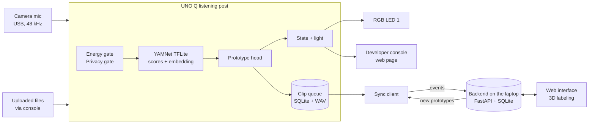

# BioSpectra: how the system works

**State as of 2026-11-15.** This document describes what exists and is verified today. It is updated whenever a change is accepted.

## In one paragraph

A listening post on an Arduino UNO Q listens to nature through a microphone. Every 5 seconds it asks a small audio model what it heard and compares the sound with known classes (prototypes). A light shows the result: **quiet**, **recognized** or **needs help**. When the post is unsure, it saves the 5 s clip. People solve these clips in a web game, and their labels become new prototypes that the post downloads. The post then recognizes the sound next time, without retraining any model. Clips with human speech are dropped and never saved.

## Status of the parts

| Part | Where | Status |
|---|---|---|
| Web interface (welcome screen, challenges, 3D labeling) | `src/` (TypeScript, Vite, Three.js) | Working. Fetches live recordings from the backend and sends labels. See [The web interface](#the-web-interface) |
| Phase 0: model test bench | `bench/` (Gradio) | Done |
| Phase 1: listening post runtime | `device/` | Done, verified on the UNO Q |
| Developer console (control the post from one page) | `device/console.py` | Done, running on the UNO Q |
| Phase 2: backend (clips, labels, prototypes) | `backend/` (FastAPI, SQLite, runs on the laptop) | Done, the full loop verified with the UNO Q |
| 2D labeling page (older stand-in) | `backend/web/play.html`, served at `/play` | Done. The web interface replaces it for players |
| Server status page | `backend/web/server.html`, served at `/` | Done |
| Phase 3: game connected to the backend | `src/game/backend.ts`, `src/ui/puzzle.ts` | Done. Live recordings open as puzzles, labels go back to the backend |
| Phase 4: end-to-end demo | `demo/`, `/screen` | Done. 3 runs in a row pass on the laptop and with the UNO Q |
| Phase 5: tools (demo set builder, STL sculpture) | `tools/` | Partly: demo set builder, mixer, test sets, prototypes, playlists. STL sculpture missing |
| Phase 6: port details (autostart, Modulino knob and buzzer) | | Open. The device runs on the board, but by hand |

## Architecture



Data flows in a loop: the post queues what it does not know, players label it, the backend turns labels into prototypes, and the post downloads them.

## The listening post, step by step

One decision per 5 s of audio (`device.decision_hop_s`). Measured on the UNO Q: about 100 to 160 ms per decision, about 150 to 250 MB of RAM.

1. **Capture.** `arecord` reads the camera mic (`plughw:CARD=Camera,DEV=0`) at 48 kHz mono. The mic gain is set to 60 % at start, because 100 % clipped.
2. **Resample and window.** The 5 s clip is resampled to 16 kHz and cut into 6 windows of 0.975 s (YAMNet's input size, read from the model file).
3. **One inference per window.** YAMNet TFLite (int8, LiteRT, 4 threads) returns two things per window: scores for 521 AudioSet classes, and a 1024-number embedding (a fingerprint of the sound).
4. **Energy gate.** A clip quieter than −55 dBFS in every window is **quiet**.
5. **Privacy gate.** It reuses the same scores, so it needs no extra inference. Speech classes (Speech, Conversation, Narration, Child speech and more) are checked per window. The clip counts as speech if 2 or more windows score ≥ 0.5, or one window scores ≥ 0.8. Speech means **quiet**, and the clip is dropped and never saved.
6. **Clip embedding.** The mean of the L2-normalised window embeddings of the non-silent windows.
7. **Prototype head.** The cosine similarity to every class prototype (the mean embedding of its examples). Current prototypes: `frog`, `chirping_birds`, `crow`, `noise:rain`, `noise:wind`, `noise:engine` (5 examples each, from ESC-50).
   * An animal class with similarity ≥ `T_known` (0.80) and a lead of ≥ 0.05 over the second class is **recognized** (green).
   * A noise class (`noise:*`) with similarity ≥ `t_noise` (0.65) is **quiet**. A missed gust costs nothing. A false alarm costs player time.
   * Anything else is **needs help** (amber).
8. **Events, not snippets.** "Needs help" segments become sound events (see below). Recognized sounds are only counted (for example `frog × 37` in the last hour). Nothing is sent for them.
9. **Light.** A 2 s hold stops flicker. The state goes to RGB LED 1 on the board and to the console page.
10. **Sync.** Every 5 s, the post uploads queued events to the backend and asks for newer prototypes (reporting the version it has installed). Without a backend it stays offline, and the queue keeps growing.

### From uncertain segments to puzzles

Sending every uncertain 5 s segment would flood players with short, cut-off, repetitive snippets. The post therefore builds **events** (`device/events.py`, settings under `events:` in `config.yaml`):

* **Merge.** Consecutive "needs help" segments form one event. One quiet or recognized segment in between does not split it (`gap_tolerance` 1). Two in a row end it.
* **Context.** The saved audio starts 2 s before the first uncertain segment and ends 2 s after the last one. The audio comes from a rolling 49 s history buffer.
* **Length cap.** An event is cut after 30 s. The rest continues as a new event.
* **Privacy.** A speech segment ends an event at once, with no context after it. The context before an event never reaches back into a speech segment.
* **Repeats.** Before saving, every 5 s segment of the new event is compared with the segments of events saved in the last 24 h. If at least 80 % of its segments have a twin with similarity ≥ 0.90 in one saved event, it is a **repeat**: the saved event's `heard_count` goes up, and its audio is replaced only if the new recording is louder (clearer) and not uploaded yet. An event with even one or two new sounds in it is saved.
* **Budget.** At most 20 new events per hour. When the budget is used up, a new event replaces the least novel waiting event only if it is more novel (novelty = 1 − mean best prototype similarity). Otherwise it is dropped and counted.

Each saved event carries its length, heard count, novelty, quality (mean level in dBFS), the best guess and a timeline of its uncertain segments.

**Measured on 24 minutes of real soundscapes** (the 8 excerpts, Amazon and Sapsucker Woods): the old approach would have produced about 79 separate 5 s snippets. The event approach saved 7 events of about 24 s and counted 34 repeats. On the UNO Q, the demo playlist played 11 times gave exactly 2 events (crickets 7 s, insects 9 s), each heard 11 times, and speech was never saved.

**Limit:** YAMNet fingerprints describe the overall sound of 5 s. In a dense dawn chorus, two segments with different bird species can still look alike, so some new species inside a chorus may be counted as a repeat. The thresholds favour saving too much over losing a new sound.

The **trust knob** (console slider now, Modulino knob later) maps 0..1 onto `T_known` 0.40 to 0.95. Higher means more cautious: fewer sounds are called recognized, more go to players.

## How the post learns

The model never changes. Only the prototypes do.

* A prototype file is JSON with `model_id`, `embedding_dim`, a `version` that grows with every change, and the mean embedding plus example count per class. A file for another model or embedding size is rejected.
* The post swaps in a newer file while running: from the backend (`GET /prototypes/latest`) or from a newer local file `data/prototypes/<model>.prototype.json`. That is how prototypes exported from the bench reach the post today.
* One example is enough to create a class. In the bench, one labelled treefrog recording made a second recording land at similarity 0.89 to 0.91.
* The starting prototypes come from `python -m tools.make_prototypes` (ESC-50). The backend seeds itself from that file and then adds every accepted player label. See [The backend](#the-backend-phase-2).

## Why YAMNet TFLite

Few-shot test on ESC-50: 18 nature classes, 720 clips, training and test from different recordings.

| Model | 5 examples per class | On the UNO Q | Peak RAM |
|---|---:|---|---:|
| Perch 2.0 | 0.88 | does not fit (TensorFlow, ~1.4 GB) | 1,263 to 1,440 MB |
| **YAMNet TFLite** | **0.86** | **9 ms per window** | **95 MB** |
| YAMNet (TensorFlow) | 0.83 | not installed | 617 MB |
| BirdNET 2.4 int8 | 0.71 | 278 ms per 3 s window | 146 MB |

BirdNET is tuned to birds and separates rain, saws and engines poorly. YAMNet TFLite is nearly as accurate as Perch, tiny, needs no TensorFlow, and also serves as the speech filter. BirdNET stays installed for optional bird labels in the console.

Threshold calibration (`python -m tools.calibrate_threshold`, 5 examples, unknown classes held out):

| Model | Suggested `T_known` | Known sounds recognized | New sounds sent to players |
|---|---:|---:|---:|
| yamnet-tflite | 0.80 | 65 % | 88 % |
| birdnet-2.4-int8 | 0.40 | 38 % | 85 % |

## Privacy

* Speech is detected on the post and the clip is dropped before anything is saved. Calibration: 3 of 3 speech clips dropped, 0 of 43 frog, cicada and rain clips dropped. Real speech recordings are still needed to confirm this in the field.
* Queued clips can still contain voices that were too quiet or too short to count as speech. At the venue, the live mic queued 10 such ambient clips. Download and delete them through the console.
* The console API needs an access token, because the board is on a shared network.

## Hardware setup

* **Board:** Arduino UNO Q, ABX00162 (2 GB RAM, about 1.7 GB visible), Debian 13.1, Python 3.13.5, 4 cores, hostname `biddie`.
* **Microphone:** the Arduino USB camera's mic, through a **USB-C hub with Power Delivery**. The hub's cable goes into the board, power goes into the hub's PD port, and the camera goes into a USB-A port. An unpowered hub must not be used.
* **Power:** at the moment the hub's PD port is fed from the Mac (about 15 W). The board restarted once under load. A 30 W or stronger USB-C charger on the PD port is recommended.
* **Network:** Wi-Fi `Junction2026`, preferred over `Hype-Guest` (priority 100 vs −10). The board is at `10.0.41.141`. The venue network lets direct connections through, but drops discovery broadcasts (mDNS). That is why Arduino App Lab says "no boards found". SSH by IP works.
* **Access:** with the hub attached, the board's only USB port is busy, so access is over Wi-Fi only: `ssh arduino@10.0.41.141` with an SSH key tagged `biospectra-dev` (the board's password is not known to us). With the board directly on USB-C (no hub), ADB works without a password.
* **Light:** RGB LED 1 (`/sys/class/leds/unoq:user-{red,green,blue}1`), writable by the `arduino` user. Off = quiet, green = recognized, amber = needs help.

## Running it

### On the board (developer console)

```bash
ssh arduino@10.0.41.141 'bash ~/spetrum/tools/device_ctl.sh start'
ssh arduino@10.0.41.141 'bash ~/spetrum/tools/device_ctl.sh url'
```

Open the printed address in a browser on the same network. It contains the access token. After about 15 s the page shows the board's status. Then:

* **Listen to mic** starts the live listener. **Play demo playlist** plays `data/playlist` (speed adjustable). **Stop** ends either.
* **Analyze files on the board:** drop audio or video files. The browser converts them to WAV, and the board analyzes each 5 s segment like live audio, without queueing or changing the light.
* **Clips on the board:** play, download one or all (zip), delete.

Other commands: `device_ctl.sh status`, `device_ctl.sh log`, `device_ctl.sh stop`. The console does **not** start by itself after a reboot yet.

First-time setup of a board: `git clone https://github.com/stepkono/spetrum.git && bash spetrum/tools/board_setup.sh`, then copy `data/prototypes/` and `data/playlist/` from the Mac (`scp`). `data/` is not in git.

### On the Mac

```bash
.venv/bin/python -m device.console --port 8766 --no-token    # console with the Mac's microphone
.venv/bin/python -m bench.app                                # Phase 0 model bench
.venv/bin/python -m backend.app                              # backend + labeling page, http://localhost:8000
.venv/bin/python -m tools.seed_gold                          # optional: hidden gold clips
.venv/bin/python -m pytest -q tests                          # 30 tests
npm install && npm run dev                                   # web interface (Vite), talks to the backend on port 8000
```

### Returning the board

```bash
ssh arduino@10.0.41.141 'bash -s' < tools/board_cleanup.sh
```

It removes the code, the Python environment, model caches, recordings, the Wi-Fi priority change and the SSH key. A full reflash is the cleanest hand-over.

## Developer console API

All `/api` routes need the token (`X-Token` header or `?token=`).

| Route | What it does |
|---|---|
| `GET /` | The console page |
| `GET /api/status` | Mode, model, threshold, prototypes, queue, mic, memory |
| `GET /api/events` | Server-Sent Events: every decision and status change |
| `POST /api/mode` | `{"mode": "mic" \| "playlist" \| "idle", "path", "speed"}` |
| `POST /api/knob` | `{"value": 0..1}` sets `T_known` |
| `POST /api/analyze?name=&birdnet=1` | Body: WAV. Returns per-segment light, labels, similarities, spectrogram |
| `GET /api/clips` | Queued events (length, heard count, novelty, timeline) |
| `GET /api/clips/<id>.wav` | One clip (`?download=1` to save) |
| `GET /api/clips.zip` | All clips plus `clips.json` |
| `POST /api/clips/delete` | `{"ids": [...]}`, or all when empty |

## The backend (Phase 2)

Runs on the laptop: `python -m backend.app` (port 8000). Storage: `data/backend/` (SQLite `backend.db` and the event WAVs).

**What happens to an event:**

1. **Upload.** The post sends each event (`POST /devices/{id}/clips`, WAV + metadata). Re-uploads of the same id are ignored.
2. **Puzzle.** `GET /puzzles/next` hands a player the open event heard most often, then the most novel one. With `gold_rate` 0.2, a hidden gold clip (known answer) is served instead. Gold clips look like normal puzzles.
3. **Selection.** The game shows `GET /clips/{id}/spectrogram` (dB grid, at most 192 × 640, with time and frequency axes). The player marks the call as boxes (seconds and Hz) or as a grid mask. `POST /clips/{id}/preview` returns the masked audio to listen to.
4. **Label.** `POST /clips/{id}/labels` with one of the labels (the three target species from `backend.labels`, `noise` or `other`) and the mask.
5. **Consensus.** A label is accepted when `consensus_n` (2) players with reliability ≥ 0.4 agree. In `demo_mode`, one label is enough.
6. **Learning.** The accepted label's audio, **masked to the player's selection**, is embedded with the same model as the post (YAMNet TFLite). The embedding is added to that class's prototype. The version goes up and is published. `noise` becomes a quiet class on the post. `other` is accepted but not learned (no prototype for "unknown").
7. **Delivery.** The post fetches the new version within 5 s, swaps it in and keeps a local copy. On its next check it reports the installed version, and the backend announces `device_updated`. The labeling page then shows "The forest device learned this sound".

**Gold clips and reliability.** `python -m tools.seed_gold` adds sounds with known answers (from recordings not used for the prototypes). A right answer moves the player's reliability towards 1, a wrong one towards 0 (step 0.2). Gold answers never change the prototypes.

**Endpoints:**

| Route | What it does |
|---|---|
| `GET /` | Status page: waiting recordings, posts online, links to the website, `/screen` and `/play` |
| `GET /play` | The older 2D labeling page |
| `POST /devices/{device_id}/clips` | multipart `audio` (WAV, one event) + `metadata` (JSON: clip id, model id, time, best guess, similarities, embedding, duration, heard count, novelty, quality, timeline) |
| `POST /players` | `{"nickname"}` → `{"player_id"}` |
| `GET /puzzles/next?player_id=` | next puzzle (204 when there is none) |
| `GET /clips/{id}/audio` | WAV |
| `GET /clips/{id}/spectrogram` | dB grid, `freqs` (row lower edges), `times` (column starts) |
| `POST /clips/{id}/preview` | `{"mask": {"boxes": [{t0, t1, f0, f1}]}}` or `{"mask": {"grid": [[...]]}}` → masked WAV |
| `POST /clips/{id}/labels` | `{"player_id", "label", "mask"?}` → accepted, votes, prototype version, or gold feedback |
| `GET /prototypes/latest?model_id=&device_id=&have=` | prototype JSON (204 when there is none). `device_id` and `have` confirm installs |
| `GET /events/stream` | Server-Sent Events: `clip_received`, `label_submitted`, `label_accepted`, `prototype_published`, `device_updated`, `gold_answered` |
| `GET /clips` | waiting recordings with post location, views and disagreement |
| `GET /clips/{id}` | one recording's details |
| `DELETE /clips/{id}`, `DELETE /clips` | delete one waiting recording, or all of them (labelled and gold clips stay) |
| `POST /learning` | debug switch: `{"enabled": false}` stores accepted labels without learning new sounds (kept in `settings.json`, survives restarts) |
| `POST /prototypes/reset` | forget everything learned: publish the starting sounds as a new version (older versions stay) |
| `POST /prototypes/forget/{label}` | forget one sound class and publish that as a new version |
| `GET /events`, `GET /stats` | recent events, counts, players, prototype version, label options |

The labeling page at `/play` is the older 2D stand-in for the game: spectrogram (log frequency), drag boxes, play all or the selection, label buttons, a live feed and keyboard control (`N`, `P`, `S`, `C`, `1`–`5`).

## The web interface

The website in `src/` is where people label recordings. Start it with `npm run dev`. It talks to the backend at the same host on port 8000 (or `?backend=<url>`). `npm run build` makes a static build that runs from any path.

* **Welcome screen.** It states the mission and the task in three steps. Then it shows the challenge list as cards and as pins on a map of Finland. Hovering a card highlights its pin, and the other way round.
* **Categories.** **Newest** lists the live recordings that the listening posts could not recognize, straight from the backend (`GET /clips`). **Hottest**, **Most viewed** and **Least viewed** list the challenges. Challenges are built-in practice clips with known answers. Their places, times and numbers are demo data. A card shows where and when the sound was recorded. Clicking a card opens exactly that recording. **Next** follows the list on screen.
* **Delete recordings.** In Newest, one recording or all of them can be deleted from the server. The page asks for confirmation first.
* **Labeling card.** A live recording is cut into 5 s parts. The player paints the call in the 3D landscape on each part, picks a label and sends it. All parts become one mask on the backend's spectrogram grid. Skip moves on to another recording. When none are left, the card says so in plain words.
* **Tools.** A navigation bar with the painting tools and an eraser. The landscape is revealed along the time axis when a recording opens. The panels are frosted glass.
* **DJ timeline.** The waveform at the bottom scrolls past a fixed needle. Press and hold to stop it under the hand. Drag left to play forward and right to rewind. A flick keeps the speed, slows down and then plays on. The played part is coloured.
* **View lab.** A panel to change the look: the modes Voxels, Drop lines, Spiral and Symmetry, the themes Classic, Glacier, Lagoon, Plum, Horizon and Dawn, sliders for amplitude and resolution, and a switch for the isometric camera.
* **Brand.** The site uses the ecco logo (Echo Rays concept) from `public/brand/` and `src/ui/brand.ts`. All logo concepts are in `brand/logos/` (open `index.html` there).

Open ideas for the interface are collected in `spectrum-todo.md` (onboarding, difficulty grades, tool tuning), each marked open, in progress or done.

## The end-to-end demo (Phase 4)

```bash
make demo                         # backend + laptop listening post, opens the event screen and the labeling page
make demo-check                   # the same, plus the scripted scenario 3 times (acceptance)
bash demo/run_demo.sh --board     # the UNO Q is the listening post (add --auto for the 3 runs)
```

**Scenario** (clips in `data/demo/`, built and verified by `python -m tools.make_demo_set`):

1. Unknown sound A (crickets, an ESC-50 recording the post never saw) plays. The post needs help and sends the event.
2. A player boxes the unclear part on the labeling page and labels it `crickets`.
3. New prototypes reach the post (one to two seconds after the label).
4. A and A2, another crickets recording, are now recognized.
5. A rain clip raised a false alarm in step 1. Labelled `noise`, it is quiet in the replay.

The demo set builder only accepts clips that pass every step with the real model and the real starting prototypes (A2 is recognized at similarity 0.86 after learning from A alone).

**Event screen** (`http://localhost:8000/screen?device=<console url>&token=<token>`): the post's light live, a timeline of everything that happens, the similarity of the learned sound to every class before and after the update, and a checklist of the 5 steps that ticks itself off from the real events.

**Repeatable runs.** `POST /demo/reset` (only in demo mode) forgets all events and labels and republishes the backend's first stored prototype version as a new, higher version, so the post forgets what it learned. The console's `POST /api/demo/reset` clears the post's queue and counters. The demo uses its own data folders (`data/demo/`) through the overlay `demo/config.demo.yaml` (laptop) or `demo/config.board.yaml` (board).

**Measured:**

| Listening post | Runs passed | Loop (A needs help → A recognized) | Label → installed on the post |
|---|---|---|---|
| Laptop | 3 / 3 | 21.2 s | 0.8 s |
| UNO Q over Wi-Fi | 3 / 3 | 23.6 to 24.4 s | 1.4 to 2.0 s |

The plan requires under 30 s and three runs in a row without a restart.

## Configuration

Everything is in `config.yaml`. The most important keys:

| Key | Value | Meaning |
|---|---|---|
| `device.model_id` | `yamnet-tflite` | Embedding model on the post |
| `device.privacy_model_id` | `yamnet-tflite` | Speech filter (same model = one inference) |
| `device.backend_url` | empty | Backend address. Empty = offline |
| `audio.device` | `plughw:CARD=Camera,DEV=0` | ALSA microphone |
| `audio.mic_gain_percent` | 60 | Capture gain set at start |
| `head.t_known_by_model` | 0.80 (yamnet-tflite) | Recognition threshold per model |
| `head.t_noise` | 0.65 | Lower threshold for noise classes |
| `head.knob_range` | 0.40 to 0.95 | Range of the trust knob |
| `gates.energy_dbfs` | −55 | Silence threshold |
| `gates.privacy.*` | 0.5, 2 windows, 0.8 | Speech rule |
| `runtime.clip_seconds` | 5 | Segment length per decision |
| `events.pre_roll_s` / `post_roll_s` | 2 / 2 | Context around an event |
| `events.gap_tolerance` | 1 | Segments allowed between uncertain segments of one event |
| `events.max_event_s` | 30 | Longest event |
| `events.dedup_similarity` / `dedup_coverage` | 0.90 / 0.8 | When an event counts as a repeat |
| `events.budget_per_hour` | 20 | New events per hour |
| `backend.labels` | frog, chirping_birds, crow | Placeholder for the three local target species |
| `backend.consensus_n` / `demo_mode` | 2 / true | Answers needed to accept a label (demo: 1) |
| `backend.gold_rate` | 0.2 | Share of hidden gold puzzles |

Machine-specific values go into `config.local.yaml` (git-ignored, merged on top). On the board it holds `device.backend_url: http://10.0.41.129:8000`.

## Where data lives

| What | Path |
|---|---|
| Prototypes | `data/prototypes/<model>.prototype.json` |
| Queued events | `data/queue/` (WAV files + `queue.db`, older databases are migrated automatically) |
| Decision log | `data/device_events.jsonl` |
| Console log, process id, token | `data/device.log`, `data/device.pid`, `data/console_token` |
| Demo playlist | `data/playlist/` (+ `expected.json`) |
| ESC-50 subset | `data/esc50/` (Mac only) |
| Real soundscapes (1.1 GB) | `data/soundscapes/` (Mac only): `amazon/`, `northeast/` (one-hour FLAC), `anuraset/frogs/`, `anuraset/no_frogs/` (one-minute WAV), `excerpts/` (busiest 3 min as WAV, ready for the console) |
| Backend data | `data/backend/` (laptop): `backend.db`, `clips/*.wav` |
| Demo data | `data/demo/` (laptop and board): `before/`, `after/`, `manifest.json`, separate backend, queue and prototypes |
| Model files | `~/.local/share/birdnet`, `~/.cache/kagglehub` (board) |

`data/` is git-ignored on both machines.

## Repository map

```
core/      audio, models (YAMNet, BirdNET, Perch adapters), gates, heads, state, queue, measure
device/    runtime (listener), events (merging, context), sources (mic, file, playlist), hardware (LED, web light),
           sync client, console (server + web/console.html), main (CLI without console)
bench/     Phase 0 Gradio bench
backend/   Phase 2: store (SQLite), service (puzzles, consensus, learning), app (FastAPI), web/server.html, web/play.html, web/screen.html
demo/      Phase 4: run_demo.sh, scenario.py, config overlays for laptop and board
tools/     board setup/cleanup, device_ctl, mixer, test sets, ESC-50 import,
           threshold calibration, prototypes, playlists, soundscape download and excerpts
tests/     core, events, device acceptance, console API, backend (full loop)
src/       web interface (TypeScript): ui/ (welcome, puzzle, timeline, View lab), view/ (3D modes, themes), game/ (backend client, challenges)
public/    static files for the web interface, including the logo
brand/     logo concepts (brand/logos/)
docs/      this document
```

## Verified results

* **Tests:** 30 pass on the Mac (`pytest -q tests`). 11 of them need `data/prototypes/` and `data/playlist/` and are skipped without them.
* **Web build:** `npm run build` passes.
* **Phase 4 acceptance:** 3 of 3 scripted runs in a row, on the laptop (21 s loop) and with the UNO Q (24 s loop). See [The end-to-end demo](#the-end-to-end-demo-phase-4).
* **Phase 2 acceptance:** automated with a real backend server: the device's events appear as puzzles, a label with a box selection publishes a new version, the device installs it and recognizes the sound on the next play.
* **Phase 2 on the real board:** the UNO Q uploaded its 18 queued events to the laptop. The insects event was boxed and labelled `noise` on the labeling page. The board installed prototypes v31 within seconds, and on the next playlist run the insects clip stayed quiet (noise 0.85) instead of asking for help.
* **Phase 1 acceptance on the UNO Q:** the 8-clip demo playlist produced the expected light for 8 of 8 clips. Unknown sounds were queued, speech was not. Newer backend prototypes swapped in within 5 s (test backend).
* **Console on the UNO Q:** live mic start and stop, upload analysis (about 0.1 s per segment), clip download, zip and delete.
* **First real soundscapes** (device pipeline on the Mac, same model and prototypes as the board): a busy frog minute from a Brazilian wetland (AnuraSet) was recognized as frog in 12 of 12 segments. Three minutes of Amazon rainforest gave 11 segments "chirping birds" and 25 "needs help". The bird prototype comes from ESC-50 and only partly matches rainforest birds. These are the clips players should label.

## Test audio

| Set | What it is | How to get it |
|---|---|---|
| ESC-50 (18 classes, 720 clips of 5 s) | Separate sound events: frog, insects, birds, rain, wind, chainsaw, engine and more | `python -m tools.import_esc50` after downloading the ESC-50 zip |
| Demo playlist (8 clips) | Clips from ESC-50 recordings not used for the prototypes, plus speech and silence, with the expected light | `python -m tools.make_playlist` |
| Real soundscapes (about 1.1 GB) | Continuous field recordings: 4 one-hour Amazon rainforest recordings, 4 one-hour Sapsucker Woods (NY) recordings, 20 busy and 4 frog-free one-minute Brazilian wetland recordings | `python -m tools.fetch_soundscapes`, then `python -m tools.soundscape_excerpts` for 3-minute WAV pieces that fit the console upload |

The soundscape tool pulls single recordings out of the remote Zenodo archives (49 GB in total) and picks the busiest ones by their own annotations. Licenses and credits are in `LICENSES.md` (CC BY 4.0 and CC BY).

## Known issues and open points

* **No autostart.** After a reboot, start the console again with `device_ctl.sh start`.
* **Power.** The board restarted once while the hub was powered from the Mac. Use a proper charger.
* **Queued venue clips.** The board holds ambient clips from the venue that may contain voices.
* **Dense choruses.** Some new species inside a dawn chorus may be counted as a repeat (see the limit above).
* **No ffmpeg on the board** (needs sudo). WAV, FLAC, OGG and AIFF load without it. The console converts everything else in the browser.
* **Knob and buzzer.** The Modulino knob and buzzer are not connected yet. They need the App Lab bridge to the microcontroller.
* **Speech filter.** It was calibrated on synthetic speech only.
* **Perch weights license** is not verified. BirdNET weights are non-commercial.
* **Web game rain stem.** The "Rain drops" recording in the web game contains musical tones and should be replaced.
* **Target species.** `backend.labels` still holds placeholders (frog, chirping birds, crow). The team decides the three local species.
* **Repeat counts after upload.** A repeat the post hears after an event was uploaded is counted on the post only. The backend keeps the count from upload time.
* **Backend access.** The backend has no login. It is meant for the laptop on the event network.
* **Venue clips on the laptop.** The board's earlier venue clips were uploaded to the backend with the demo events. They may contain voices: delete `data/backend` before sharing the laptop data.
* **Practice challenges.** Hottest, Most viewed and Least viewed show practice clips with demo places, times and numbers, not real statistics.
* **Demo species.** The demo teaches `crickets`, which is in the demo's label list only (`demo/config.demo.yaml`). Replace it with a real target species once the team has chosen them.
* **Board after a board demo.** `run_demo.sh --board` restarts the board's console with the demo overlay. Restart it normally afterwards (`device_ctl.sh start`).

## Change log

* **2026-11-15** New hackathon README (idea, how it works, stack, models, setup, history, outlook). The old technical README moved to `docs/TECHNICAL.md`.
* **2026-11-15** Community archive is a full-screen page with filters by kind of sound. Each stamp is the real 3D landscape rendered from straight above (JPEG, about 45 KB). Stamps live on the server and everyone sees them. An empty archive offers to add the 5 practice landscapes as examples, and the server page can delete all stamps (`DELETE /archive`). A landscape now plays its reveal once when it opens, not twice.
* **2026-11-15** Archive: labelled recordings and contributed challenges become sound stamps (abstract top views, own gradient) in a personal archive in the browser. A stamp opens its landscape again.
* **2026-11-15** Server page at `/` lists waiting recordings (listen, delete one or all) and the known sounds (forget one, reset to the starting sounds). Devices now follow the server's prototype version also downward.
* **2026-11-15** New web interface merged into main: welcome screen, Newest with live recordings, challenges, labeling card, DJ timeline, View lab, delete recordings. Backend status page at `/`, labeling page moved to `/play`. ecco logo concepts added.
* **2026-11-14** Phase 4: one-command demo (`make demo`), scripted 5-step scenario, event screen, verified demo set, demo reset. 3/3 runs on the laptop and on the UNO Q. Fixed: a device on the backend's machine could overwrite the backend's seed file.
* **2026-11-14** Phase 2 backend: events become puzzles, gold clips, reliability, consensus, learning from the player's selection, prototype versions, install confirmation, event stream, 2D labeling page. Full loop verified with the UNO Q.
* **2026-11-14** Uncertain segments become events with 2 s context, speech-safe, repeats counted per segment, hourly budget. Recognized sounds are counted. Verified on soundscapes and the UNO Q.
* **2026-11-14** Real soundscapes downloaded (Amazon, Northeastern US, AnuraSet subset), with tools to fetch and cut them. First field-audio results.
* **2026-11-14** Developer console on the board: live control, file analysis, clip offload. Board reboot traced to power. This document created.
* **2026-11-14** Phase 1 listening post, verified 8/8 on the UNO Q. Thresholds calibrated. Noise prototypes split per type.
* **2026-11-14** ESC-50 comparison: device model switched from BirdNET to YAMNet TFLite.
* **2026-11-14** Phase 0 bench and shared `core/` pipeline.
* **2026-11-14** Web game prototype.
