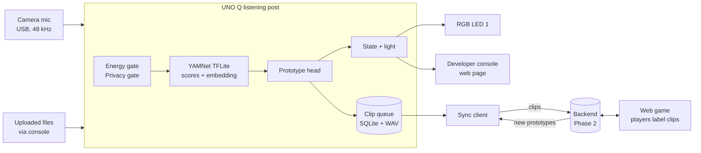

# BioSpectra: how the system works

**State as of 2026-11-14.** This document describes what exists and is verified today. It is updated whenever a change is accepted.

## In one paragraph

A listening post on an Arduino UNO Q listens to nature through a microphone. Every 5 seconds it asks a small audio model what it heard and compares the sound with known classes (prototypes). A light shows the result: **quiet**, **recognized** or **needs help**. When the post is unsure, it saves the 5 s clip. People solve these clips in a web game, and their labels become new prototypes that the post downloads. The post then recognizes the sound next time, without retraining any model. Clips with human speech are dropped and never saved.

## Status of the parts

| Part | Where | Status |
|---|---|---|
| Web game prototype (3D spectrogram, TinyML experiment) | `src/` (TypeScript, Vite, Three.js) | Working demo. Not yet connected to the Python side |
| Phase 0: model test bench | `bench/` (Gradio) | Done |
| Phase 1: listening post runtime | `device/` | Done, verified on the UNO Q |
| Developer console (control the post from one page) | `device/console.py` | Done, running on the UNO Q |
| Phase 2: backend (clips, labels, prototypes) | `backend/` | Not started. The device already speaks its API |
| Phase 3: game connected to the backend | `game/` | Not started |
| Phase 4: end-to-end demo script | `demo/` | Not started |
| Phase 5: tools (demo set builder, STL sculpture) | `tools/` | Partly: mixer, test sets, prototypes, playlists |
| Phase 6: port details (autostart, Modulino knob and buzzer) | | Open. The device runs on the board, but by hand |

## Architecture



Data flows in a loop: the post queues what it does not know, players label it, the backend turns labels into prototypes, and the post downloads them.

## The listening post, step by step

One decision per 5 s of audio (`device.decision_hop_s`). Measured on the UNO Q: about 100 to 160 ms per decision, about 150 to 250 MB of RAM.

1. **Capture.** `arecord` reads the camera mic (`plughw:CARD=Camera,DEV=0`) at 48 kHz mono. The mic gain is set to 60 % at start, because 100 % clipped.
2. **Resample and window.** The 5 s clip is resampled to 16 kHz and cut into 6 windows of 0.975 s (YAMNet's input size, read from the model file).
3. **One inference per window.** YAMNet TFLite (int8, LiteRT, 4 threads) returns two things per window: scores for 521 AudioSet classes, and a 1024-number embedding (a fingerprint of the sound).
4. **Energy gate.** A clip quieter than −55 dBFS in every window is **quiet**.
5. **Privacy gate.** It reuses the same scores, so it needs no extra inference. Speech classes (Speech, Conversation, Narration, Child speech and more) are checked per window. The clip counts as speech if 2 or more windows score ≥ 0.5, or one window scores ≥ 0.8. Speech means **quiet**, and the clip is dropped and never saved.
6. **Clip embedding.** The mean of the L2-normalised window embeddings of the non-silent windows.
7. **Prototype head.** The cosine similarity to every class prototype (the mean embedding of its examples). Current prototypes: `frog`, `chirping_birds`, `crow`, `noise:rain`, `noise:wind`, `noise:engine` (5 examples each, from ESC-50).
   * An animal class with similarity ≥ `T_known` (0.80) and a lead of ≥ 0.05 over the second class is **recognized** (green).
   * A noise class (`noise:*`) with similarity ≥ `t_noise` (0.65) is **quiet**. A missed gust costs nothing. A false alarm costs player time.
   * Anything else is **needs help** (amber).
8. **Queue.** A "needs help" clip is saved as WAV with its embedding, best guess and similarities (at most one per 10 s of audio).
9. **Light.** A 2 s hold stops flicker. The state goes to RGB LED 1 on the board and to the console page.
10. **Sync.** Every 5 s, the post tries to upload queued clips and fetch newer prototypes. Without a backend it stays offline, and the queue keeps growing.

The **trust knob** (console slider now, Modulino knob later) maps 0..1 onto `T_known` 0.40 to 0.95. Higher means more cautious: fewer sounds are called recognized, more go to players.

## How the post learns

The model never changes. Only the prototypes do.

* A prototype file is JSON with `model_id`, `embedding_dim`, a `version` that grows with every change, and the mean embedding plus example count per class. A file for another model or embedding size is rejected.
* The post swaps in a newer file while running: from the backend (`GET /prototypes/latest`) or from a newer local file `data/prototypes/<model>.prototype.json`. That is how prototypes exported from the bench reach the post today.
* One example is enough to create a class. In the bench, one labelled treefrog recording made a second recording land at similarity 0.89 to 0.91.
* Today the starting prototypes come from `python -m tools.make_prototypes` (ESC-50). Later they come from player labels through the backend.

## Why YAMNet TFLite

Few-shot test on ESC-50: 18 nature classes, 720 clips, training and test from different recordings.

| Model | 5 examples per class | On the UNO Q | Peak RAM |
|---|---:|---|---:|
| Perch 2.0 | 0.88 | does not fit (TensorFlow, ~1.4 GB) | 1,263 to 1,440 MB |
| **YAMNet TFLite** | **0.86** | **9 ms per window** | **95 MB** |
| YAMNet (TensorFlow) | 0.83 | not installed | 617 MB |
| BirdNET 2.4 int8 | 0.71 | 278 ms per 3 s window | 146 MB |

BirdNET is tuned to birds and separates rain, saws and engines poorly. YAMNet TFLite is nearly as accurate as Perch, tiny, needs no TensorFlow, and also serves as the speech filter. BirdNET stays installed for optional bird labels in the console.

Threshold calibration (`python -m tools.calibrate_threshold`, 5 examples, unknown classes held out):

| Model | Suggested `T_known` | Known sounds recognized | New sounds sent to players |
|---|---:|---:|---:|
| yamnet-tflite | 0.80 | 65 % | 88 % |
| birdnet-2.4-int8 | 0.40 | 38 % | 85 % |

## Privacy

* Speech is detected on the post and the clip is dropped before anything is saved. Calibration: 3 of 3 speech clips dropped, 0 of 43 frog, cicada and rain clips dropped. Real speech recordings are still needed to confirm this in the field.
* Queued clips can still contain voices that were too quiet or too short to count as speech. At the venue, the live mic queued 10 such ambient clips. Download and delete them through the console.
* The console API needs an access token, because the board is on a shared network.

## Hardware setup

* **Board:** Arduino UNO Q, ABX00162 (2 GB RAM, about 1.7 GB visible), Debian 13.1, Python 3.13.5, 4 cores, hostname `biddie`.
* **Microphone:** the Arduino USB camera's mic, through a **USB-C hub with Power Delivery**. The hub's cable goes into the board, power goes into the hub's PD port, and the camera goes into a USB-A port. An unpowered hub must not be used.
* **Power:** at the moment the hub's PD port is fed from the Mac (about 15 W). The board restarted once under load. A 30 W or stronger USB-C charger on the PD port is recommended.
* **Network:** Wi-Fi `Junction2026`, preferred over `Hype-Guest` (priority 100 vs −10). The board is at `10.0.41.141`. The venue network lets direct connections through, but drops discovery broadcasts (mDNS). That is why Arduino App Lab says "no boards found". SSH by IP works.
* **Access:** with the hub attached, the board's only USB port is busy, so access is over Wi-Fi only: `ssh arduino@10.0.41.141` with an SSH key tagged `biospectra-dev` (the board's password is not known to us). With the board directly on USB-C (no hub), ADB works without a password.
* **Light:** RGB LED 1 (`/sys/class/leds/unoq:user-{red,green,blue}1`), writable by the `arduino` user. Off = quiet, green = recognized, amber = needs help.

## Running it

### On the board (developer console)

```bash
ssh arduino@10.0.41.141 'bash ~/spetrum/tools/device_ctl.sh start'
ssh arduino@10.0.41.141 'bash ~/spetrum/tools/device_ctl.sh url'
```

Open the printed address in a browser on the same network. It contains the access token. After about 15 s the page shows the board's status. Then:

* **Listen to mic** starts the live listener. **Play demo playlist** plays `data/playlist` (speed adjustable). **Stop** ends either.
* **Analyze files on the board:** drop audio or video files. The browser converts them to WAV, and the board analyzes each 5 s segment like live audio, without queueing or changing the light.
* **Clips on the board:** play, download one or all (zip), delete.

Other commands: `device_ctl.sh status`, `device_ctl.sh log`, `device_ctl.sh stop`. The console does **not** start by itself after a reboot yet.

First-time setup of a board: `git clone https://github.com/stepkono/spetrum.git && bash spetrum/tools/board_setup.sh`, then copy `data/prototypes/` and `data/playlist/` from the Mac (`scp`). `data/` is not in git.

### On the Mac

```bash
.venv/bin/python -m device.console --port 8766 --no-token    # console with the Mac's microphone
.venv/bin/python -m bench.app                                # Phase 0 model bench
.venv/bin/python -m pytest -q tests                          # 15 tests
```

### Returning the board

```bash
ssh arduino@10.0.41.141 'bash -s' < tools/board_cleanup.sh
```

It removes the code, the Python environment, model caches, recordings, the Wi-Fi priority change and the SSH key. A full reflash is the cleanest hand-over.

## Developer console API

All `/api` routes need the token (`X-Token` header or `?token=`).

| Route | What it does |
|---|---|
| `GET /` | The console page |
| `GET /api/status` | Mode, model, threshold, prototypes, queue, mic, memory |
| `GET /api/events` | Server-Sent Events: every decision and status change |
| `POST /api/mode` | `{"mode": "mic" \| "playlist" \| "idle", "path", "speed"}` |
| `POST /api/knob` | `{"value": 0..1}` sets `T_known` |
| `POST /api/analyze?name=&birdnet=1` | Body: WAV. Returns per-segment light, labels, similarities, spectrogram |
| `GET /api/clips` | Queued clips |
| `GET /api/clips/<id>.wav` | One clip (`?download=1` to save) |
| `GET /api/clips.zip` | All clips plus `clips.json` |
| `POST /api/clips/delete` | `{"ids": [...]}`, or all when empty |

## Interfaces the backend must provide (Phase 2)

The sync client already uses these:

* `POST /devices/{device_id}/clips`: multipart with `audio` (WAV) and `metadata` (JSON: clip id, model id, time, best guess, similarities, embedding)
* `GET /prototypes/latest?model_id=...`: the prototype JSON, or 204/404 when there is none

## Configuration

Everything is in `config.yaml`. The most important keys:

| Key | Value | Meaning |
|---|---|---|
| `device.model_id` | `yamnet-tflite` | Embedding model on the post |
| `device.privacy_model_id` | `yamnet-tflite` | Speech filter (same model = one inference) |
| `device.backend_url` | empty | Backend address. Empty = offline |
| `audio.device` | `plughw:CARD=Camera,DEV=0` | ALSA microphone |
| `audio.mic_gain_percent` | 60 | Capture gain set at start |
| `head.t_known_by_model` | 0.80 (yamnet-tflite) | Recognition threshold per model |
| `head.t_noise` | 0.65 | Lower threshold for noise classes |
| `head.knob_range` | 0.40 to 0.95 | Range of the trust knob |
| `gates.energy_dbfs` | −55 | Silence threshold |
| `gates.privacy.*` | 0.5, 2 windows, 0.8 | Speech rule |
| `runtime.clip_seconds` | 5 | Clip length |

## Where data lives

| What | Path |
|---|---|
| Prototypes | `data/prototypes/<model>.prototype.json` |
| Queued clips | `data/queue/` (WAV files + `queue.db`) |
| Decision log | `data/device_events.jsonl` |
| Console log, process id, token | `data/device.log`, `data/device.pid`, `data/console_token` |
| Demo playlist | `data/playlist/` (+ `expected.json`) |
| ESC-50 subset | `data/esc50/` (Mac only) |
| Real soundscapes (1.1 GB) | `data/soundscapes/` (Mac only): `amazon/`, `northeast/` (one-hour FLAC), `anuraset/frogs/`, `anuraset/no_frogs/` (one-minute WAV), `excerpts/` (busiest 3 min as WAV, ready for the console) |
| Model files | `~/.local/share/birdnet`, `~/.cache/kagglehub` (board) |

`data/` is git-ignored on both machines.

## Repository map

```
core/      audio, models (YAMNet, BirdNET, Perch adapters), gates, heads, state, queue, measure
device/    runtime (listener), sources (mic, file, playlist), hardware (LED, web light),
           sync client, console (server + web/console.html), main (CLI without console)
bench/     Phase 0 Gradio bench
tools/     board setup/cleanup, device_ctl, mixer, test sets, ESC-50 import,
           threshold calibration, prototypes, playlists, soundscape download and excerpts
tests/     core, device acceptance, console API
src/       web game prototype (TypeScript)
docs/      this document
```

## Verified results

* **Tests:** 15 pass on the Mac (`pytest -q tests`).
* **Phase 1 acceptance on the UNO Q:** the 8-clip demo playlist produced the expected light for 8 of 8 clips. Unknown sounds were queued, speech was not. Newer backend prototypes swapped in within 5 s (test backend).
* **Console on the UNO Q:** live mic start and stop, upload analysis (about 0.1 s per segment), clip download, zip and delete.
* **First real soundscapes** (device pipeline on the Mac, same model and prototypes as the board): a busy frog minute from a Brazilian wetland (AnuraSet) was recognized as frog in 12 of 12 segments. Three minutes of Amazon rainforest gave 11 segments "chirping birds" and 25 "needs help". The bird prototype comes from ESC-50 and only partly matches rainforest birds. These are the clips players should label.

## Test audio

| Set | What it is | How to get it |
|---|---|---|
| ESC-50 (18 classes, 720 clips of 5 s) | Separate sound events: frog, insects, birds, rain, wind, chainsaw, engine and more | `python -m tools.import_esc50` after downloading the ESC-50 zip |
| Demo playlist (8 clips) | Clips from ESC-50 recordings not used for the prototypes, plus speech and silence, with the expected light | `python -m tools.make_playlist` |
| Real soundscapes (about 1.1 GB) | Continuous field recordings: 4 one-hour Amazon rainforest recordings, 4 one-hour Sapsucker Woods (NY) recordings, 20 busy and 4 frog-free one-minute Brazilian wetland recordings | `python -m tools.fetch_soundscapes`, then `python -m tools.soundscape_excerpts` for 3-minute WAV pieces that fit the console upload |

The soundscape tool pulls single recordings out of the remote Zenodo archives (49 GB in total) and picks the busiest ones by their own annotations. Licenses and credits are in `LICENSES.md` (CC BY 4.0 and CC BY).

## Known issues and open points

* **No autostart.** After a reboot, start the console again with `device_ctl.sh start`.
* **Power.** The board restarted once while the hub was powered from the Mac. Use a proper charger.
* **Queued venue clips.** The board holds ambient clips from the venue that may contain voices.
* **No ffmpeg on the board** (needs sudo). WAV, FLAC, OGG and AIFF load without it. The console converts everything else in the browser.
* **Knob and buzzer.** The Modulino knob and buzzer are not connected yet. They need the App Lab bridge to the microcontroller.
* **Speech filter.** It was calibrated on synthetic speech only.
* **Perch weights license** is not verified. BirdNET weights are non-commercial.
* **Web game rain stem.** The "Rain drops" recording in the web game contains musical tones and should be replaced.
* **Phase 2 to 4** (backend, game connection, demo script) are not built yet.

## Change log

* **2026-11-14** Real soundscapes downloaded (Amazon, Northeastern US, AnuraSet subset), with tools to fetch and cut them. First field-audio results.
* **2026-11-14** Developer console on the board: live control, file analysis, clip offload. Board reboot traced to power. This document created.
* **2026-11-14** Phase 1 listening post, verified 8/8 on the UNO Q. Thresholds calibrated. Noise prototypes split per type.
* **2026-11-14** ESC-50 comparison: device model switched from BirdNET to YAMNet TFLite.
* **2026-11-14** Phase 0 bench and shared `core/` pipeline.
* **2026-11-14** Web game prototype.
